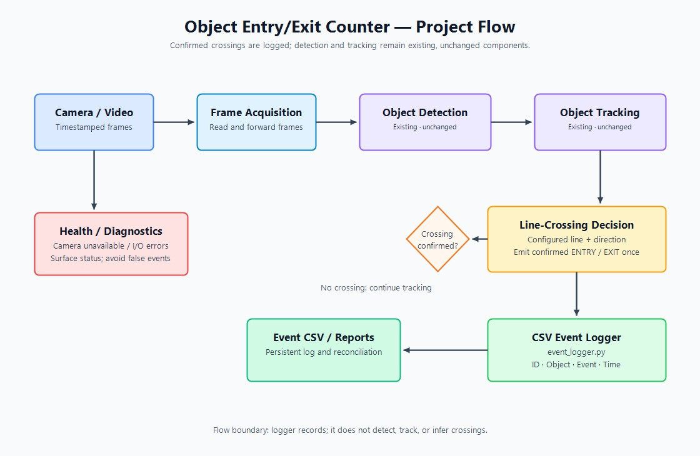

# VISIONTRACK

**Real-Time Object Detection, Tracking and Entry–Exit Monitoring**

VISIONTRACK is a Python computer-vision project that detects and tracks objects in a webcam feed, counts crossings over a configurable line, records entry and exit events, and presents the results in a Streamlit monitoring dashboard.

The project combines **Ultralytics YOLO11**, **ByteTrack**, **OpenCV**, and **Streamlit** to demonstrate a complete local detection-to-dashboard workflow.

## Dashboard preview



> The screenshot above is loaded from `assets/dashboard-preview.png`. Make sure your screenshot has this exact filename, including the extension and capitalization.

## Features

- Real-time object detection from a local webcam using YOLO11 nano (`yolo11n.pt`)
- Persistent object tracking using ByteTrack IDs
- Entry and exit detection when tracked objects cross a counting line
- CSV event logging with timestamps, object classes, and event types
- Streamlit dashboard with live detection snapshots and summary metrics
- Object-class analytics, traffic charts, and event history
- Event filtering and CSV export from the dashboard
- Camera frame freshness and event-file status indicators
- Automated counter tests using pytest

## Technology stack

| Component | Technology |
| --- | --- |
| Language | Python |
| Detection | Ultralytics YOLO11 nano |
| Tracking | ByteTrack |
| Video processing | OpenCV |
| Dashboard | Streamlit |
| Analytics | Pandas and Plotly |
| Event storage | CSV |
| Testing | pytest |

## Repository structure

```text
VISIONTRACK/
├── assets/
│   └── dashboard-preview.png
├── docs/
│   ├── architecture.md
│   ├── test_plan.md
│   └── test_results.md
├── tests/
│   ├── test_counter.py
│   ├── test_detector.py
│   └── test_tracker.py
├── main.py
├── detector.py
├── tracker.py
├── counter.py
├── counting_statistics.py
├── event_logger.py
├── dashboard.py
├── live_dashboard.py
├── requirements.txt
├── .gitignore
└── README.md
```

`events.csv`, `latest_frame.jpg`, local virtual environments, and model weights are intentionally excluded from version control. These files are generated or obtained locally.

## Installation

### Prerequisites

- Python 3.12 recommended (the project was tested locally with Python 3.12)
- A working webcam
- Internet access for the initial YOLO model download
- Git (for cloning the repository)

### 1. Clone the repository

```bash
git clone https://github.com/YOUR_USERNAME/VISIONTRACK.git
cd VISIONTRACK
```

Replace `YOUR_USERNAME` with your GitHub username once the repository is published.

### 2. Create and activate a virtual environment

**Windows PowerShell**

```powershell
python -m venv .venv
.\.venv\Scripts\Activate.ps1
```

**macOS / Linux**

```bash
python3 -m venv .venv
source .venv/bin/activate
```

### 3. Install dependencies

```bash
python -m pip install -r requirements.txt
```

The required packages include `ultralytics`, `opencv-python`, `streamlit`, `streamlit-autorefresh`, `pandas`, `plotly`, and `Pillow`. If you plan to run the automated tests, install `pytest` as well. These should be listed in `requirements.txt`.

### 4. Model weights

The `yolo11n.pt` weights file is not committed to this repository. Ultralytics can download the standard weights automatically the first time the tracker loads the model, provided internet access is available.

## Running VISIONTRACK

Run both programs from the repository root, using **two separate terminals**.

**Terminal 1 — detection and tracking**

```bash
python main.py
```

This starts the webcam, performs object detection and tracking, draws the counting line, and records crossing events. Press **Q** or **Esc** in the OpenCV window to stop.

**Terminal 2 — monitoring dashboard**

```bash
python -m streamlit run live_dashboard.py
```

Open the local URL displayed by Streamlit (typically `http://localhost:8501`).

The dashboard reads:

- `events.csv` for historical entry and exit records
- `latest_frame.jpg` for the latest processed camera image

The dashboard refreshes periodically. Its camera panel displays snapshots written by `main.py`, not a separate webcam connection.

## How the system works

```text
Webcam
   |
   v
OpenCV frame capture
   |
   v
YOLO11 object detection
   |
   v
ByteTrack object IDs
   |
   v
Line-crossing counter
   |
   +----------------------+
   |                      |
   v                      v
CSV event logger     Annotated camera frame
   |                      |
   v                      v
events.csv           latest_frame.jpg
   |                      |
   +-----------+----------+
               |
               v
      Streamlit dashboard
```

The counter determines crossing events from tracked object positions. The logger records those events, while the dashboard presents the accumulated data and most recently saved frame.

## Testing

Run the test suite from the repository root:

```bash
python -m pytest tests -v
```

**Latest verified local result:** 17 tests passed in 1.57 seconds. All 17 collected tests in that run came from `tests/test_counter.py`; detector and tracker test collection has not yet been confirmed.

The counter tests cover crossing direction, duplicate-crossing prevention, movement near the line, count resets, and related behaviors.

## Data and privacy

The application processes a local webcam feed and writes event records and annotated frames to the project directory. These files may contain sensitive scene information and are excluded by `.gitignore`:

```gitignore
events.csv
latest_frame.jpg
.venv/
__pycache__/
yolo11n.pt
```

Review screenshots before publishing them to avoid exposing private or identifiable information.

## Limitations

- The current implementation uses a local webcam and runs on the host computer.
- The dashboard's occupancy estimate is calculated from recorded entries minus exits; tracking errors and historical events can affect its accuracy.
- CSV totals persist between sessions, while the overlay counters in `main.py` reset when the tracker restarts.
- The dashboard displays periodically refreshed JPEG frames rather than a continuous low-latency video stream.
- Detection and tracking performance depend on lighting, camera placement, occlusion, and model accuracy.

## Documentation

- [System architecture](docs/architecture.md)
- [Test plan](docs/test_plan.md)
- [Test results](docs/test_results.md)

## Future improvements

Potential extensions include multi-camera support, database-backed event storage, configurable counting zones, and session-based analytics.

---

**VISIONTRACK** — Local real-time computer-vision monitoring and analytics.
